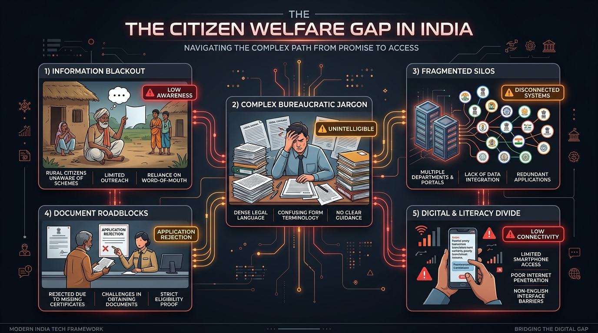
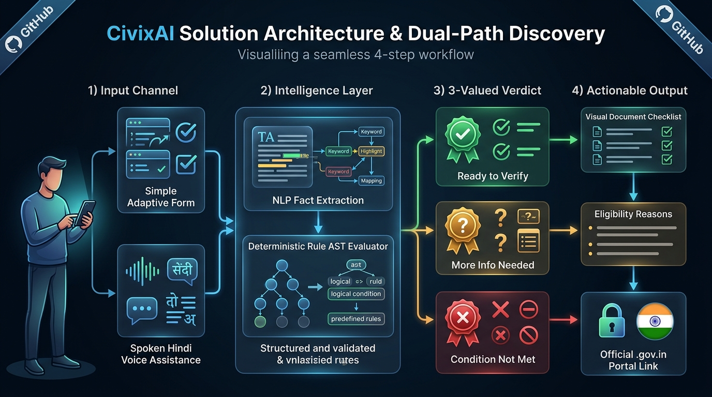
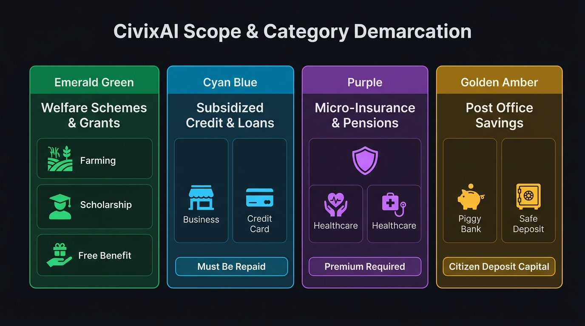
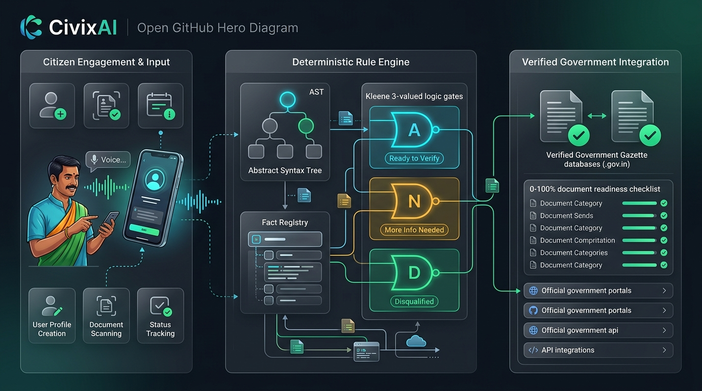
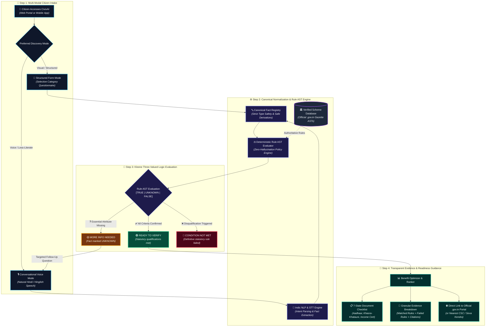
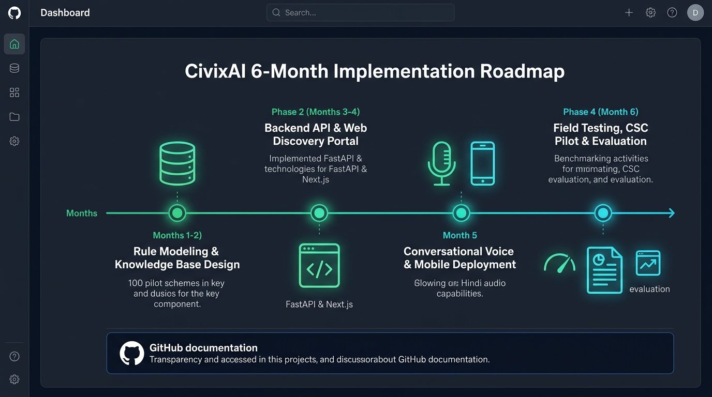

# CivixAI 🏛️🇮🇳

> **AI-Powered Web & Mobile Platform for Discovering Government Schemes, Loans, Insurance, and Savings — Specially Designed for Rural Citizens**

[](https://nextjs.org/)
[](https://react.dev/)
[](https://www.typescriptlang.org/)
[](https://fastapi.tiangolo.com/)
[](https://www.python.org/)
[](https://tailwindcss.com/)
[](#-deterministic-statutory-architecture)
[](./LICENSE)

---

## 🗺️ Quick Navigation & Table of Contents

<div align="center">

| 🏛️ **Platform Overview** | ⚖️ **Scope & Accessibility** | ⚙️ **Architecture & Engine** |
| :--- | :--- | :--- |
| 🔹 [Executive Summary](#-executive-summary--background)<br>🔹 [Problem Statement (6 Gaps)](#-the-problem-statement)<br>🔹 [The CivixAI Solution](#-the-civixai-solution)<br>🔹 [Project Objectives (11 Goals)](#-project-objectives--principles) | 🔹 [Existing Portals vs. CivixAI](#-comparison-existing-portals-vs-civixai)<br>🔹 [Rural & Inclusive Voice UX](#-rural--inclusive-accessibility-design)<br>🔹 [Scope & Product Demarcation](#-project-scope--category-demarcation) | 🔹 [Architecture Infographic](#-system-architecture--workflow)<br>🔹 [Interactive Flowchart](#-interactive-system-flowchart)<br>🔹 [Deterministic AST Engine](#-deterministic-statutory-architecture)<br>🔹 [Technology Stack](#-technology-stack) |

| 🗣️ **Citizen Journeys & Voice** | 🛡️ **Trust & Quality** | 🚀 **Developer Guide** |
| :--- | :--- | :--- |
| 🔹 [College Student (Hindi Chat)](#journey-1-college-student-conversational-hindi)<br>🔹 [Rural Farmer Voice Session](#journey-2-rural-farmer-voice-assisted-consultation)<br>🔹 [Shop Owner (MSME Loan)](#journey-3-micro-entrepreneur-shop-owner) | 🔹 [8-Point Verification System](#-verification-trust--feedback-mechanism)<br>🔹 [Automated Test Invariants](#-testing--validation)<br>🔹 [Official `.gov.in` Sources](#-official-sources--citations) | 🔹 [Project Roadmap (4 Phases)](#-project-roadmap-4-phases)<br>🔹 [Quickstart Installation](#-quickstart--installation)<br>🔹 [Expected Social Impact](#-expected-social-impact--future-scope) |

</div>

---

## 📖 Executive Summary & Background

India operates thousands of central and state government schemes designed to uplift students, farmers, women, senior citizens, unorganized workers, small entrepreneurs, and low-income families. Beyond welfare grants, there is a vast spectrum of subsidized government-backed credit (loans), life and health insurance, social security pensions, and post-office savings instruments.

However, a massive last-mile delivery deficit persists:
- Over **₹2+ Lakh Crore ($25B+)** in welfare entitlements remain unclaimed annually.
- In rural communities and tier-2/tier-3 towns, millions of deserving citizens **never hear about schemes** that could transform their livelihood.
- Official portals like **myScheme** list **5,100+ schemes**, yet checking eligibility remains daunting because statutory rules are buried in complex bureaucratic prose and scattered across hundreds of departmental websites.

**CivixAI** bridges this gap as an AI-powered civic intelligence platform, available via web and mobile. Citizens can discover benefits either by **filling a simple form** or by **speaking/typing naturally in Hindi, Hinglish, or English**. Both pathways share a unified, deterministic eligibility engine that transparently explains:
1. Exactly **why** each option matched.
2. What information or documentation is **still missing**.
3. **Where and how** to officially apply.

> [!NOTE]
> **CivixAI does not replace official portals.** Instead, it serves as an intelligent, accessible discovery layer that routes citizens to verified `.gov.in` endpoints with complete document readiness.

---

## ⚠️ The Problem Statement

Despite abundant welfare budgets, ordinary citizens encounter six systemic hurdles:

<p align="center">
  
  <br>
  <em><b>Figure 1:</b> The Citizen Welfare Gap in India — Visualizing Information Blackouts, Legal Jargon, Siloed Portals, Document Roadblocks, and the Rural Literacy Divide.</em>
</p>

1. **Information Blackout:** Millions never hear about schemes targeted specifically for their trade, caste, landholding, or income bracket.
2. **Complex Bureaucratic Jargon:** Statutory eligibility conditions are written in legalistic, inaccessible language that intimidates ordinary citizens.
3. **Fragmented Silos:** Guidelines are dispersed across 100+ separate Union, State, bank, and insurance websites without interoperability.
4. **Document Roadblocks:** Citizens make multiple costly visits to offices only to be rejected at counters due to an uncollected certificate.
5. **Wrong or Outdated Information:** Third-party blogs and unofficial websites circulate expired criteria, leading to wasted applications.
6. **Digital & Literacy Divide:** Rural populations with basic smartphones, intermittent 2G/4G, and limited literacy struggle with multi-page text forms.

---

## 💡 The CivixAI Solution

CivixAI provides a unified, transparent discovery ecosystem combining accessible interaction with deterministic statutory evaluation:

<p align="center">
  
  <br>
  <em><b>Figure 2:</b> CivixAI Solution Workflow — Dual-Path Discovery (Form + Hindi Voice), NLP Fact Extraction, Deterministic Rule AST Evaluator, and Actionable Readiness Output.</em>
</p>

### Core Solution Principles:
1. **Dual-Path Discovery:** Choice between a clean, adaptive form or natural voice chat in **Hindi, Hinglish, or English**.
2. **AI Language Separated from Rule Logic:** Natural language understanding handles dialogue, while statutory eligibility is evaluated exclusively by a deterministic AST rule engine. Zero hallucinations.
3. **Graceful Handling of Incomplete Data (Kleene 3-Valued Logic):** Missing details stay `More Information Needed` rather than false negative rejection.
4. **Transparent Evidence & Provenance:** Every recommendation clearly displays matched criteria, failed rules, missing facts, and official `.gov.in` citations.
5. **Clear Financial Demarcation:** Distinct classification of free grants, repayable loans, insurance plans, and savings deposits.

---

## ⚖️ Comparison: Existing Portals vs. CivixAI

| Dimension | Existing Portals (e.g., myScheme) | CivixAI (Proposed Platform) |
|---|---|---|
| **Search Modality** | Profile-based structured filters + scheme-specific Yes/No questionnaire | **Dual-Path**: Adaptive form OR conversational voice/chat in Hindi/Hinglish/English |
| **Product Coverage** | Primarily government schemes and subsidies | **Holistic Spectrum**: Welfare schemes, subsidized loans, micro-insurance, pensions & post-office savings |
| **Handling Missing Data** | Binary Yes/No; an unfulfilled or skipped criterion can drop the scheme | **Kleene 3-Valued Logic**: Incomplete inputs marked as `Unconfirmed`; engine asks clarifying questions |
| **Decision Transparency** | Static scheme page detailing generic eligibility text | **Granular Evidence**: Exact matched conditions, failed rules, missing facts & official gazette links |
| **Actionable Next Step** | Outbound official portal hyperlink | **Readiness Score (0–100%)**, visual document checklist + verified `.gov.in` submission link |
| **Rural Accessibility** | Text-heavy web UI designed for general computer users | **Voice-First**: Hindi speech recognition, read-aloud TTS, visual document icons, assisted VLE/CSC mode |
| **Approval Claims** | Directs to department | **Explicit Disclaimers**: Clarifies that discovery is not final sanction; approval rests with issuing authority |

---

## 🌾 Rural & Inclusive Accessibility Design

For rural citizens and individuals with limited reading skills, CivixAI acts like a patient, knowledgeable helper sitting right beside them:

- 🎙️ **Voice-First Dialogue:** Speak freely in Hindi or Hinglish (`"Mujhe kheti ke liye beej aur khaad ki madad chahiye"`).
- 🔊 **Read-Aloud Answers:** Results and instructions are spoken back in natural, friendly voice audio.
- 📱 **One Question at a Time:** Complex multi-field forms are broken down into bite-sized conversational cards with large Yes/No or icon taps.
- 🖼️ **Visual Document Badges:** Documents to bring (Aadhaar, Ration Card, Khasra-Khatauni, Income Certificate) are displayed with recognizable visual badges and icons.
- 🤝 **Assisted Facilitation Mode:** Designed so Village-Level Entrepreneurs (VLEs) at **Common Service Centres (CSCs)** or literate family members can run assessments on behalf of others.

---

## 🎯 Project Objectives & Principles

1. **Universal Usability:** Provide a voice-enabled, low-cognitive-load interface accessible to citizens regardless of literacy levels.
2. **Unified Core Engine:** Ensure both form-based and conversational searches share identical, deterministic statutory logic.
3. **Multilingual Support:** Full support for Hindi, Hinglish, and English across web and mobile.
4. **Contextual Filtering:** Granular filtering by location (state/district), caste category, landholding, education, and occupation.
5. **Verified Pilot Knowledge Base:** Launch with a verified seed of **~100 high-impact schemes for Uttar Pradesh** (Agriculture, Education, MSME, Social Welfare) before scaling to the full 5,100+ national catalog.
6. **Multi-Product Taxonomy:** Separate records and conditions for schemes, loans, insurance, and post-office savings.
7. **Readiness Scoring & Checklists:** Generate actionable document checklists and a 3-state readiness indicator:
   - `Ready to verify`
   - `More information needed`
   - `Condition not met`
8. **Need-Based Grouping:** Group related benefits (e.g., Higher Education support) without false double-counting or benefit conflation.
9. **Traceability & Freshness:** Track official source URL, last-verified date, and revision history for every rule; flag records older than 180 days for human review.
10. **Zero-Trust Privacy:** **Never request or store Aadhaar numbers, bank passwords, PINs, or OTPs**. Collect only anonymized eligibility facts with user consent.
11. **Empirical Benchmarking:** Validate engine accuracy against hand-curated statutory test suites and real-world citizen testing.

---

## 📦 Project Scope & Category Demarcation

<p align="center">
  
  <br>
  <em><b>Figure 3:</b> CivixAI 4-Pillar Product Scope — Strict Separation of Grants, Repayable Credit, Insurance Protections, and Citizen Savings.</em>
</p>

| Category Pillar | Description & Characteristics | Example Products Covered |
|---|---|---|
| 🟢 **Welfare Schemes & Grants** | Non-repayable welfare benefits and subsidies directly funded by Union/State budgets | PM-KISAN, UP Post-Matric Scholarship, Free Ration Scheme |
| 🔵 **Subsidized Credit & Loans** | Formal financial assistance; **must be repaid** according to agreed bank EMI schedules | Mudra Loans (Shishu/Kishore), PM SVANidhi, Kisan Credit Card (KCC) |
| 🟣 **Micro-Insurance & Pensions** | Social safety nets requiring **regular premium payments**; payouts contingent on qualifying events | PMSBY (Accident), PMJJBY (Life), Atal Pension Yojana (APY) |
| 🟡 **Post Office Small Savings** | Government-backed wealth accumulation; **citizen's own deposited capital** earning interest | Sukanya Samriddhi, PPF, Monthly Income Scheme (MIS), NSC |

> [!IMPORTANT]
> **Strict Operational Boundaries:**
> - **No False Guarantees:** CivixAI provides eligibility pre-screening; formal approval rests entirely with the responsible government department or lending institution.
> - **Zero-Trust Privacy:** CivixAI **never asks for or stores Aadhaar numbers, PAN numbers, bank passwords, PINs, or OTPs**.
> - **Authorized Direct Links:** Applications are routed directly to official `.gov.in` endpoints or nearest Common Service Centres (CSCs).

---

## 🗣️ Real-World User Journeys & Voice Scenarios

### Journey 1: College Student (Conversational Hindi)
* **Citizen:** *"Main college mein hoon aur scholarship chahiye."*
* **CivixAI:** *"Aap kis state mein padhai kar rahe hain, kaunsa course hai, aur parivaar ki varshik aay (annual income) lagbhag kitni hai?"*
* **Citizen:** *"Main UP mein B.Tech kar raha hoon. Income certificate abhi nahi bana hai."*
* **CivixAI:**
  > **Match Status: Possible Option – Needs Checking (UP Post-Matric Scholarship)**
  > - **Rule Match:** Enrolled in recognized degree program (B.Tech) in Uttar Pradesh.
  > - **Pending Fact:** Family annual income must be below ₹2.5 Lakh (SC/ST) or ₹2.0 Lakh (General/OBC).
  > - **Actionable Checklist:** Apply for an Income Certificate at your local Tehsil or Edistrict portal. Here is the official link and required affidavit format.

---

### Journey 2: Rural Farmer (Voice-Assisted Consultation)
* **Farmer:** *"Mujhe kheti ke liye madad chahiye. Beej, khaad aur sinchai ka kharcha bahut badh gaya hai."*
* **CivixAI:** *"Main aapki madad karunga. Aapko kheti ke kharche ke liye sarkari anudaan chahiye, saste byaaj par loan chahiye, ya fasal beema karwana hai?"*
* **Farmer:** *"Mere paas lagbhag 1 hectare zameen hai Bijnor mein, aur ganna ugata hoon. PM-KISAN ka paisa milta hai, par kharche ke liye aur sahuliyat chahiye."*
* **CivixAI:**
  > **Recommendation 1: Kisan Credit Card (KCC) — Subsidized Agri Credit**
  > - **Status:** `Ready to verify`
  > - **Benefit:** Up to ₹3 Lakh short-term crop loan at an effective 4% interest rate (with prompt repayment incentive).
  > - **Documents Needed:** Land ownership papers (Khasra/Khatauni), Land possession certificate, Aadhaar card copy.
  >
  > **Recommendation 2: PM Fasal Bima Yojana (PMFBY) — Crop Insurance**
  > - **Status:** `Ready to verify`
  > - **Benefit:** Comprehensive insurance coverage against natural calamities for sugarcane crop at low premium.
  > - **Official Next Step:** Visit your local Bijnor District Cooperative Bank or Common Service Centre (CSC) before the sowing cutoff date.

---

### Journey 3: Micro-Entrepreneur (Shop Owner)
* **Citizen:** *"Mujhe apni kirana shop badhane ke liye ₹50,000 ka loan chahiye."*
* **CivixAI:** Analyzes requirements and recommends **PM SVANidhi** / **Mudra Shishu Loan**, explaining that this is a bank loan requiring monthly EMI repayments with interest subvention upon on-time repayment.

---

## 🏗️ System Architecture & Workflow

CivixAI is architected with a strict decoupling between **unstructured conversational interaction** and **deterministic legal evaluation**:

<p align="center">
  
  <br>
  <em><b>Figure 4:</b> CivixAI End-to-End System Pipeline — Multi-Modal Citizen Input, Deterministic Kleene 3-Valued AST Rule Engine, and Verified .gov.in Gazette Integration.</em>
</p>

### 🔄 Interactive System Flowchart



### Core Architectural Layers:
1. **Frontend App (`src/`):** Next.js 14 App Router, React 18, Tailwind CSS, Lucide icons, responsive audio capture.
2. **Backend API (`services/ml_api/`):** FastAPI asynchronous endpoints exposing `/api/v1/evaluate` and `/api/v1/schemes`.
3. **Fact Registry (`services/core/facts/`):** Canonical taxonomy defining types, boundaries, and mathematical derivations (e.g., DOB $\rightarrow$ Age).
4. **Rule AST Engine (`services/core/rules/`):** Pure Abstract Syntax Tree evaluator implementing **Kleene 3-Valued Logic** (`TRUE`, `FALSE`, `UNKNOWN`). Zero policy hardcoding.
5. **Knowledge Base (`data/`):** Cryptographically verifiable scheme database cross-referenced against official notifications.

---

## 🛡️ Verification, Trust & Feedback Mechanism

To ensure zero hallucinations and maximum citizen trust:

1. **Official Gazette Verification:** Every scheme record points to an authoritative `.gov.in` gazette or circular.
2. **Freshness Tracking:** Records maintain `last_verified_date` and audit trails. Records unverified after 180 days are flagged.
3. **No Hallucinated Rules:** The LLM is restricted to conversational facilitation; statutory evaluation is executed by static AST rules.
4. **Transparent Uncertainty:** If a rule cannot be evaluated with certainty, CivixAI tells the citizen: *"This rule requires verification with your local Block Development Office (BDO)."*
5. **Clear Financial Truth:** Subsidies are never conflated with loans. Repayment terms and insurance premiums are prominently shown.
6. **Strict Privacy Architecture:** Zero storage of Aadhaar numbers, biometric records, or banking passwords.
7. **Automated Regression Gates:** Continuous integration runs hundreds of property-based test cases against hand-audited benchmark scenarios.
8. **Citizen Feedback Loop:** Built-in error reporting allows users and CSC operators to flag policy discrepancies directly to our maintainers.

---

## 💻 Technology Stack

| Layer | Technology | Function / Usage |
|---|---|---|
| **Web Frontend** | `Next.js 14` (App Router), `TypeScript` | Server Components, responsive citizen UI, accessible layouts |
| **Styling & UI** | `Tailwind CSS 3.4`, `Radix UI`, `Lucide Icons` | High-contrast, mobile-friendly design with visual badge system |
| **Backend API** | `FastAPI`, `Uvicorn`, `Pydantic v2` | High-throughput asynchronous REST API for evaluation & search |
| **Core Language** | `Python 3.10+` | Backend business logic, statutory evaluation, data parsing |
| **Statutory Rule Engine** | Custom Kleene 3-Valued AST Evaluator | Deterministic Boolean logic (`TRUE`, `FALSE`, `UNKNOWN`) |
| **Data & Persistence** | `SQLAlchemy 2.0`, `SQLite FTS5` / `PostgreSQL` | Scheme records, rule definitions, and full-text search indexes |
| **Language & NLP** | Google Gemini / Genkit NLP | Hindi/Hinglish parsing, conversational dialogue synthesis |
| **Voice / Speech** | Web Speech API / Whisper & Indic TTS | Speech-to-text voice input and spoken audio guidance |
| **Testing & Invariants** | `pytest`, `pytest-asyncio`, `hypothesis` | Property-based testing and deterministic logic invariants |

---

## 📅 Project Roadmap (4 Phases)

The project is structured into four sequential phases over a 6-month timeline:

<p align="center">
  
  <br>
  <em><b>Figure 5:</b> CivixAI 6-Month Phased Implementation Roadmap & Key Deliverables.</em>
</p>

- **Phase 1 (Months 1–2): Rule Modeling & Knowledge Base Design**
  - Collect and verify initial seed of 100 high-priority schemes for Uttar Pradesh (Agriculture, Education, MSME).
  - Codify statutory rules into AST format with complete provenance links.
  - Establish canonical fact registry and database schemas.
- **Phase 2 (Months 3–4): Backend Engine & Web Platform**
  - Implement FastAPI endpoints and Kleene 3-valued AST evaluator.
  - Build responsive Next.js web application with form discovery and filtering.
  - Implement 7-state document readiness scoring.
- **Phase 3 (Month 5): Conversational Voice & Mobile Deployment**
  - Integrate speech-to-text (STT) and text-to-speech (TTS) for Hindi and Hinglish.
  - Launch mobile-optimized Progressive Web App (PWA) / hybrid mobile build.
  - Deploy administrative portal for source verification and rule updates.
- **Phase 4 (Month 6): Validation, Field Pilot & Final Report**
  - Validate engine accuracy against 500+ hand-curated test cases.
  - Conduct field trials with rural citizens and CSC operators in pilot districts of UP.
  - Publish performance metrics and accuracy reports.

---

## ⚡ Quickstart & Installation

### Prerequisites
- **Node.js**: v18.0.0 or higher ([Download Node.js](https://nodejs.org/))
- **Python**: v3.10 or higher ([Download Python](https://www.python.org/))
- **Git**: Installed and configured

---

### Step 1: Clone the Repository
```bash
git clone https://github.com/your-username/CivixAI.git
cd CivixAI
```

---

### Step 2: Configure Environment
Copy the example environment configuration:
```bash
cp .env.example .env
```
Add your optional API keys (e.g., `GEMINI_API_KEY` for conversational features).

---

### Step 3: Automated Launch (Windows 1-Click)
Simply run the included batch script:
```cmd
start.bat
```

---

### Step 4: Cross-Platform Manual Launch

#### 1. Setup Python Virtual Environment:
```bash
python -m venv .venv

# On Windows:
.venv\Scripts\activate
# On Linux/macOS:
source .venv/bin/activate

# Install Python backend dependencies:
pip install -r requirements.txt
```

#### 2. Install Node.js Frontend Dependencies:
```bash
npm install
```

#### 3. Start Both Services Simultaneously:
```bash
npm run dev
```

The services will be available at:
* **Frontend Web App:** [http://localhost:3000](http://localhost:3000)
* **Backend API Docs:** [http://localhost:8000/docs](http://localhost:8000/docs)
* **Health Endpoint:** [http://localhost:8000/health](http://localhost:8000/health)

---

## 🧪 Testing & Validation

CivixAI includes an exhaustive automated test suite to ensure mathematical and statutory correctness:

```bash
# Run pytest across all core engine test suites
pytest tests/ -v
```

### Key Invariants Tested:
1. **Derivation Purity:** Fact derivations in `derivation.py` are 100% free of hardcoded statutory thresholds or scheme IDs.
2. **Kleene Logic Correctness:** Missing facts strictly evaluate to `UNKNOWN` and never trigger false negative rejections.
3. **Residency vs. Domicile:** Current geographical presence does not falsely fulfill legal state domicile.
4. **Database Immutability:** Evaluation requests are side-effect free and cannot alter scheme records.

---

## 📈 Expected Social Impact & Future Scope

### Rural & Grassroots Impact
- **Equal Access for the Non-Literate:** Voice input in Hindi/Hinglish empowers citizens who cannot read or write to discover their legal entitlements.
- **Elimination of Middlemen:** Reduces reliance on predatory agents who charge commissions for basic scheme guidance.
- **Drastic Reduction in Office Visits:** Clear document checklists ensure citizens arrive at offices with the right certificates on their first visit.
- **Empowered CSC Operators:** Village-level entrepreneurs can quickly screen dozens of villagers per day with consistent accuracy.

### Future Roadmap
- 🌐 **Expansion Across India:** Scale knowledge base to all 28 States and 8 Union Territories across 12 major Indian languages.
- 📲 **Low-Bandwidth Channels:** Introduce WhatsApp and SMS-based conversational screening for areas with 2G/poor mobile data.
- 🔗 **Authorised API Integration:** Integrate with DigiLocker and UMANG APIs for automated, consent-based document verification.
- 📊 **Civic Policy Intelligence:** Provide anonymized demand dashboards to government departments highlighting unaddressed regional welfare needs.

---

## 📚 Official Sources & Citations

CivixAI cross-references and directs citizens to authoritative government sources:

1. **myScheme Portal & FAQs:** [https://www.myscheme.gov.in/faqs](https://www.myscheme.gov.in/faqs)
2. **myScheme Official Scheme Finder:** [https://search.myscheme.gov.in/](https://search.myscheme.gov.in/)
3. **National Portal of India:** [https://www.india.gov.in/](https://www.india.gov.in/)
4. **UMANG Official Portal:** [https://web.umang.gov.in/](https://web.umang.gov.in/)
5. **Ministry of Agriculture & Farmers Welfare (PM-KISAN / KCC):** [https://pmkisan.gov.in](https://pmkisan.gov.in)
6. **India Post Savings Schemes:** [https://www.indiapost.gov.in](https://www.indiapost.gov.in)

---

<p align="center">
  <b>CivixAI</b> • <i>Empowering Every Citizen with Dignity, Clarity, and Equal Access to Welfare</i> 🇮🇳
</p>
